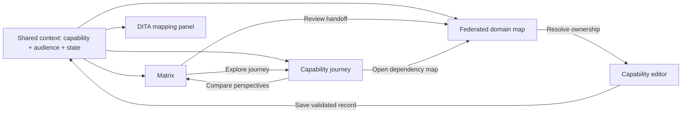
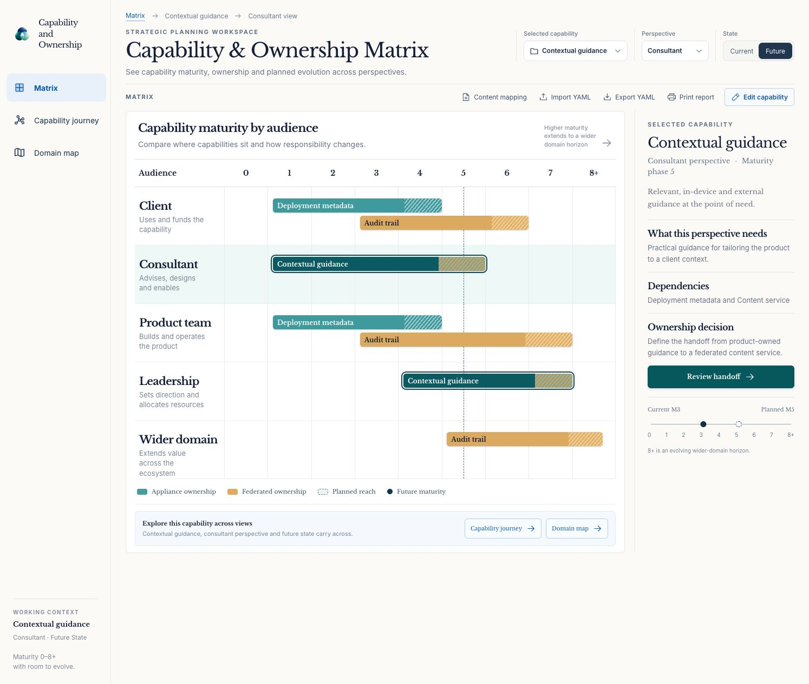
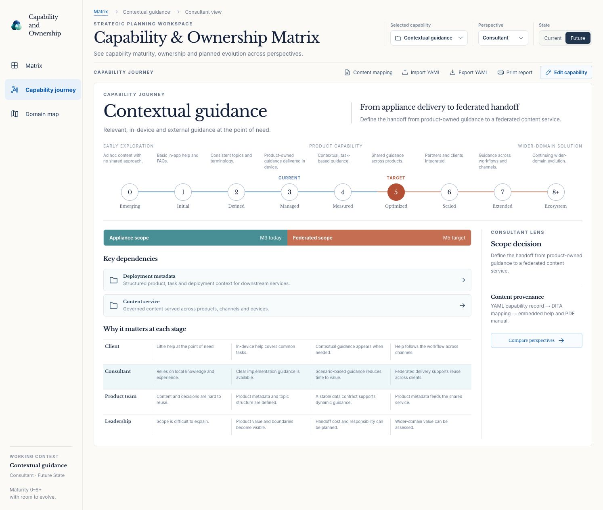
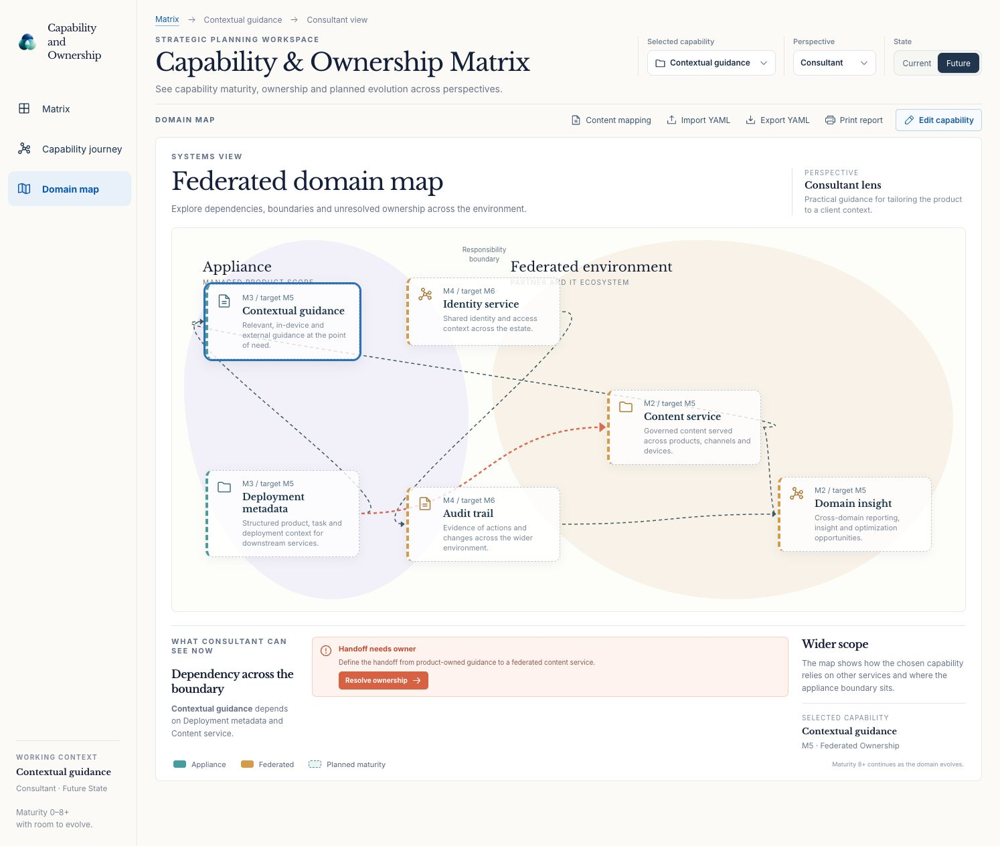
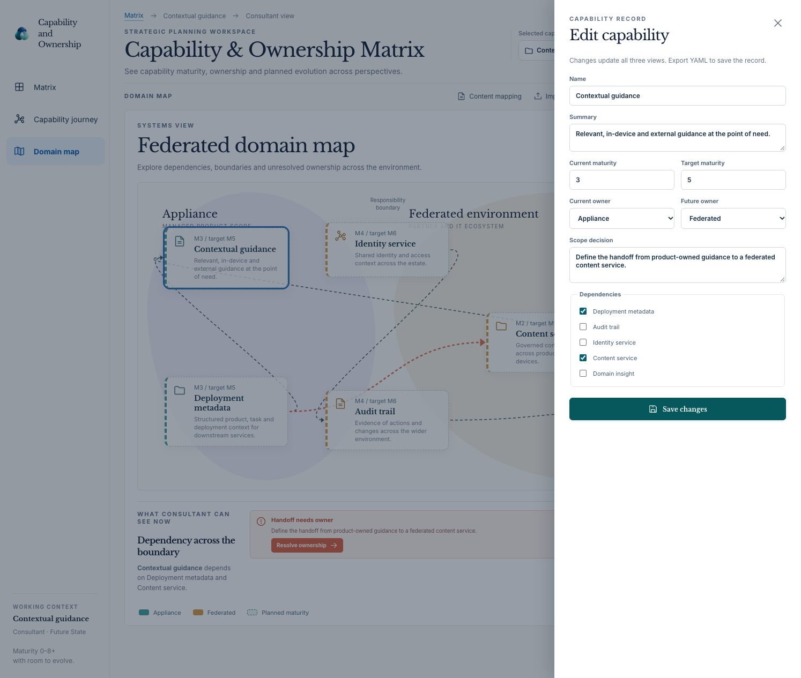
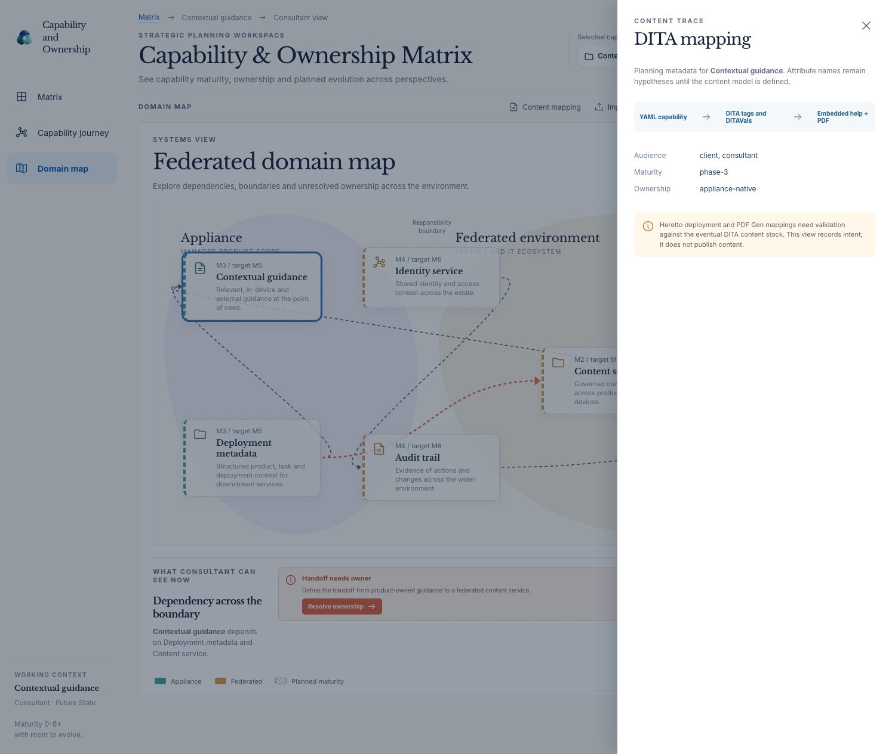

# Experience design: three views, one planning context

**Status:** Draft · **Evidence:** screenshots in this folder, `src/App.jsx:55-107`, `src/Views.jsx:19-82`, and `src/styles.css:8-28`.

## Information architecture

The shared context appears in the header and sidebar. In the prototype, the initial context is **Contextual guidance**, **Consultant**, **Future** (`src/App.jsx:55-60`). View changes preserve all three values because the controls and views use common React state (`src/App.jsx:88-101`). This is the central navigation rule.

## Screen 1 — Matrix

**Question answered:** “Where do capabilities sit for each audience, and how does their current or target maturity relate to ownership?”

- The horizontal axis displays maturity positions **0, 1, 2, 3, 4, 5, 6, 7, 8+**. The vertical axis displays five audience rows (`src/Views.jsx:7,23-41`).
- Capability bars are color coded for appliance or federated ownership. A hatched end indicates planned reach; the selected capability gets a stronger outline (`src/styles.css:12,23`).
- Selecting a bar changes the shared capability. Selecting an audience through the header changes the highlighted row and the insight explanation. The Current/Future control moves the maturity marker and changes the displayed maturity value (`src/Views.jsx:19-46`).
- The right panel provides the selected capability summary, audience need, dependencies, ownership decision, and current/target mini-scale. Its **Review handoff** action opens the map (`src/Views.jsx:43-46`).

**Design limitation:** the sample bar placement is driven by `matrixRows` in `src/model.js:68-74`. Imported capabilities without an explicit row placement get a fallback based on `dita.audience` (`src/Views.jsx:24-27`). This is a demonstration, not a complete arbitrary YAML layout algorithm. A real data-driven placement rule is an open decision.

## Screen 2 — Capability journey

**Question answered:** “How does one capability develop, what must be in place, and why does that development matter to different people?”

- The top track displays nine maturity positions and distinguishes current and target values. Stage notes explain the selected capability's evolution (`src/Views.jsx:50-56`).
- A two-part ribbon compares today’s appliance scope to the target owner. Dependency rows lead to the domain map (`src/Views.jsx:57-58`).
- Four audience lanes show illustrative stage-specific value; the selected lens is tinted (`src/Views.jsx:59-60`). The wider-domain lens appears in the header and scope context but does not yet have a journey lane.
- The side panel repeats the scope decision and sketches a content provenance path from YAML through DITA to embedded help and PDF. It does not claim that publication exists.

**Design limitation:** the contextual-guidance stage notes and four audience milestone sequences are hard-coded in the view (`src/Views.jsx:8-19`). Other capabilities use generic stage notes. Production content should be modeled or authored explicitly; it should not be inferred from the sample capability name.

## Screen 3 — Federated domain map

**Question answered:** “What depends on what, and where does responsibility cross the appliance boundary?”

- The canvas places capability nodes in appliance and federated zones. Arrows come from dependency IDs. Clicking a node selects that capability (`src/Views.jsx:64-79`).
- The selected capability is outlined. Future state uses dashed nodes and edges when the target exceeds the current maturity (`src/Views.jsx:67-79`).
- The lower explanation names dependencies and the owner transition. **Resolve ownership** opens the editor (`src/Views.jsx:80-81`).

**Design limitation:** node positions and one emphasized handoff edge are specific to the six illustrative records (`src/Views.jsx:64,77`). A production layout and edge-priority rule are still needed for larger capability sets.

## Capability editor

The editor changes the selected existing record: name, summary, current and target maturity, current and future owner, scope decision, and dependencies. An empty name or target below current shows an error. Saving invokes sidecar validation and updates all three views (`src/App.jsx:21-41,104`). In the browser preview, the user must export YAML to keep changes; in Tauri, `save_yaml` writes the canonical file.

**Proposed improvement:** treat the panel as a real modal dialog with focus entry, focus containment, Escape cancellation, and focus restoration. The current markup is a form inside a backdrop, without a `dialog` role or focus management (`src/App.jsx:31-41`). Also provide an explicit unsaved-changes path before closing.

## DITA content mapping panel

The panel reads the selected record's draft `dita` object and shows audience, maturity, and ownership values. Its message explicitly says the attribute names are hypotheses until a content model is defined (`src/App.jsx:44-52`). The flow diagram is an intended path, not a live Heretto operation.

## Key user journeys

1. **Scope a request.** Select a capability → choose an audience → inspect its Matrix position → switch Current/Future → open Journey to understand target maturity and dependencies → open Map to discuss the handoff.
2. **Prepare an ownership discussion.** Select the capability → open Map → review dependencies and boundary → open **Resolve ownership** → edit current/future owner and decision → save → inspect the updated views → export YAML.
3. **Plan content.** Select a capability and audience → open **Content mapping** → compare proposed metadata with the actual content stock → record a mapping decision outside the current read-only panel. A future workflow would create a reviewed publication configuration, not auto-publish directly from this draft.
4. **Prepare a meeting view.** Select the relevant capability, audience, state, and view → use **Print report**. The current control calls the browser print dialog for the active screen (`src/App.jsx:98`; `src/styles.css:20`). A multi-view report package is not implemented.

## Concept-to-prototype changes

The three generated concepts were standalone compositions: [integrated Matrix shell](concepts/01-integrated-shell.png), [Journey](concepts/02-capability-journey.png), and [Map](concepts/03-domain-map.png). The running design adds one persistent navigation shell and shared controls. This increases content density, especially in the Journey, but lets stakeholders switch representations without reselecting their context. The app's visual specification follows the **running prototype** for layout and interaction; concept images remain references for hierarchy and intent.
