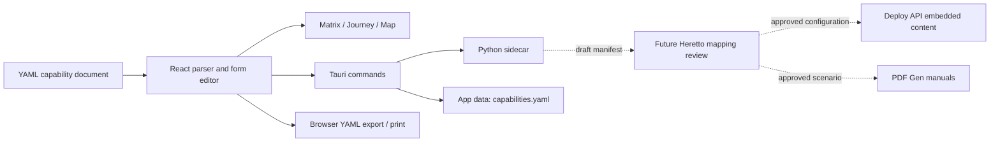

# Data and integration specification

**Status:** Draft · **Date:** 2026-10-25 · **Implementation target:** Tauri 2 desktop shell, React/Vite UI, Python sidecar. This document distinguishes the present contract from proposed production requirements.

## 1. System boundary



The dashed paths are future integration work. The current panel does not query Heretto, generate a DITAVAL, call PDF Gen, or publish content (`src/App.jsx:44-52`; `sidecar/main.py:4-6`).

## 2. Canonical YAML document

**Observed source:** `src/data/capabilities.yaml:1-99`; normalized by `src/model.js:76-100`.

```yaml
version: 1
capabilities:
  - id: contextual-guidance
    name: Contextual guidance
    current: 3
    target: 5
    owner: appliance
    futureOwner: federated
    summary: Relevant, in-device and external guidance at the point of need.
    decision: Define the handoff from product-owned guidance to a federated content service.
    dependencies:
      - deployment-metadata
      - content-service
    dita:
      audience: [client, consultant]
      maturity: phase-3
      ownership: appliance-native
```

The example is **illustrative**. It defines the current document shape, not approved capability facts or approved DITA values.

| Field | Current meaning and validation | Required next decision |
| --- | --- | --- |
| `version` | Exported as `1`; not checked by `normalizeCapabilities` | Define schema migration and reject unsupported versions |
| `id` | Nonempty, unique string | Decide stability and renaming policy |
| `name` | Nonempty string | Decide maximum length and localization |
| `current`, `target` | Nonnegative numbers; Python requires `target >= current` | Decide whether maturity is integer-only and how 8+ extends |
| `owner`, `futureOwner` | `appliance` or `federated` | Decide whether shared, unassigned, or named owner organizations are needed |
| `summary`, `decision` | Strings, default to empty in React | Decide which are required for review/publication |
| `dependencies` | Array of capability IDs; Python rejects missing references and self-reference | Decide cycle policy, dependency type, and cross-document references |
| `dita` | Free-form object in React; sample has audience, maturity, ownership | Replace hypotheses with a validated content model and controlled values |

**Current import validation:** React checks a nonempty list, basic record shape, duplicate IDs, nonnegative numeric maturity, and normalizes missing optional values (`src/model.js:76-100`). The Python sidecar additionally checks target not below current, owner enums, missing dependencies, and self-dependencies (`sidecar/main.py:13-49`). The browser preview's `runSidecar` returns success without executing Python (`src/sidecarBridge.js:3-9`); browser validation is therefore weaker than desktop validation. **Proposed requirement DATA-01:** both runtimes MUST use the same published schema and relationship checks before accepting an import or edit.

## 3. Persistence and editing

| Operation | Current behavior | Proposed production requirement |
| --- | --- | --- |
| First load | Bundled YAML is parsed; Tauri then loads saved YAML if present (`src/App.jsx:11-13,69-75`) | DATA-02: preserve and display the source path and version used |
| Edit selected record | Form updates one record and all three views after validation (`src/App.jsx:21-41,104`) | DATA-03: support explicit dirty state, Cancel/Save, and recoverable validation errors |
| Import YAML | File picker parses, validates, replaces all records, selects first (`src/App.jsx:82-87`) | DATA-04: preview differences and prevent accidental replacement of unsaved work |
| Export YAML | Downloads `capability-ownership.yaml` (`src/App.jsx:76-80`) | DATA-05: round-trip the current schema without losing unknown approved fields |
| Desktop save | `save_yaml` writes to Tauri app data (`src-tauri/src/lib.rs:14-20`) | DATA-06: atomic write, backup/recovery, and save-error handling |
| Browser save | In-memory edits until export (`src/sidecarBridge.js:12-18`) | DATA-07: show persistent visible “Not saved to file” state |

The form currently edits an existing capability only. Create, duplicate, delete, bulk edit, undo, and concurrent editing are not part of the demonstrated workflow. Their need and semantics remain open.

## 4. Python sidecar contract

The Tauri command `process_data` accepts `operation` and a JSON string payload, starts the architecture-suffixed sidecar, sends one JSON line on standard input, and reads one JSON response (`src-tauri/src/lib.rs:22-56`). The process accepts three operations (`sidecar/main.py:80-92`):

| Operation | Response | Status |
| --- | --- | --- |
| `validate` | `{ok, errors}` | Used by desktop import/edit |
| `content-manifest` | Draft mapping rows with capability, audience, maturity, ownership, and delivery targets | Implemented in Python, not surfaced as a production export |
| `report-summary` | Capability count, handoffs, unresolved references | Implemented in Python, not wired into the print UI |

The Tauri command rejects unsupported operation names and payloads over 2,000,000 bytes (`src-tauri/src/lib.rs:27-33`). **Proposed requirement INT-01:** define a versioned request and response schema, include error codes, and test the packaged sidecar on each supported platform. A successful source check or PyInstaller build does not establish packaged-runtime behavior.

## 5. DITA and Heretto content mapping

The intended editorial path is **capability record → approved content metadata and topic/map references → reviewed publication configuration → embedded help and PDF manual**. The same source content may serve both outputs, but the filtering and delivery contracts must be reviewed separately. The current `dita` object is a planning annotation (`src/App.jsx:44-52`; `src/data/capabilities.yaml:15-20`).

| Requirement ID | Proposed requirement | Approval dependency |
| --- | --- | --- |
| CONTENT-01 | Each capability mapping MUST identify the actual DITA topic or map IDs and approved conditional attributes | Content architect defines the content stock |
| CONTENT-02 | Mapping validation MUST detect missing topics, invalid attribute values, and filters that unexpectedly remove required context | DITA schema and CCMS metadata inventory |
| CONTENT-03 | Embedded help configuration MUST specify the approved Deploy API endpoint, authentication model, context parameters, locale, and fallback behavior | Product and Heretto integration design |
| CONTENT-04 | PDF manual configuration MUST specify the approved PDF Gen scenario, map, audience, locale, version, and filtering rules | Documentation publishing design |
| CONTENT-05 | A preview/diff and named approval MUST precede any generated DITAVAL, deployment configuration, or PDF scenario change | Publishing ownership and governance |
| CONTENT-06 | The UI MUST label mappings as draft until validated against the content stock | Product/content owner confirmation |

The exploratory PDF proposes `audience`, `otherprops`, `product`, and `props` values. Those are **hypotheses**, not a validated Heretto taxonomy or a production configuration. In particular, the selected attribute names, values, inheritance behavior, filter precedence, and endpoint payload are unresolved. The current sample uses `dita.audience`, `dita.maturity`, and `dita.ownership`; it does not encode topic IDs, locales, DITAVAL rules, Deploy API endpoints, or PDF Gen scenarios.

## 6. Reports and printing

The **Print report** button calls `window.print()` for the active view (`src/App.jsx:98`). The stylesheet switches to landscape, hides navigation and controls, and adjusts the view layout (`src/styles.css:20`). The Python sidecar's `report-summary` operation is separate and not used by the print action.

**Proposed requirement REPORT-01:** agree on whether a meeting report is the active view, a selected set of all three views, or a versioned snapshot. A report specification should define title, date, audience, capability scope, state, maturity rubric version, owners, dependencies, decisions, source YAML version, and any draft-content warning. **REPORT-02:** render a predictable page count with no clipped nodes or bars at the approved paper size. **REPORT-03:** distinguish a browser-printed planning report from a Heretto-generated manual.

## 7. Acceptance scenarios for data and integration

```gherkin
Scenario: Shared selection survives navigation
  Given Contextual guidance, Consultant, and Future are selected
  When I navigate from Matrix to Capability journey to Domain map
  Then the selected capability is Contextual guidance in each view
  And the audience is Consultant and the state is Future

Scenario: Desktop rejects a broken dependency
  Given a YAML document with a capability that depends on an unknown ID
  When I import the document in the Tauri app
  Then validation returns an error naming the capability and unknown dependency
  And the previously loaded capability list remains visible

@pre
Scenario: Browser and desktop validation agree
  Given the same invalid YAML document in both runtimes
  When I import it in each runtime
  Then both runtimes report the same validation error code
  And neither runtime replaces the loaded document

@pre
Scenario: Content mapping stays draft
  Given a capability whose DITA mapping has not been validated
  When I open Content mapping
  Then the panel displays a draft-status warning
  And no Deploy API or PDF Gen operation is invoked
```

## 8. Open integration decisions

1. The canonical maturity rubric and whether historical records can change once a rubric version is published.
2. The real capability placement model for arbitrary YAML records in the Matrix and a layout strategy for large domain graphs.
3. Whether dependencies represent technical prerequisites, content prerequisites, ownership handoffs, or typed relations.
4. The time-axis unit, state transitions, and whether Current/Future remains a global toggle when dated horizons are added.
5. Heretto content stock, deployment target, metadata keys, access and caching model, and PDF Gen scenario contract.
6. Ownership and approval of generated reports and publication configurations.
