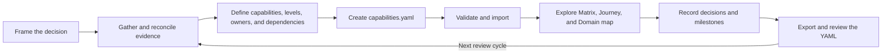
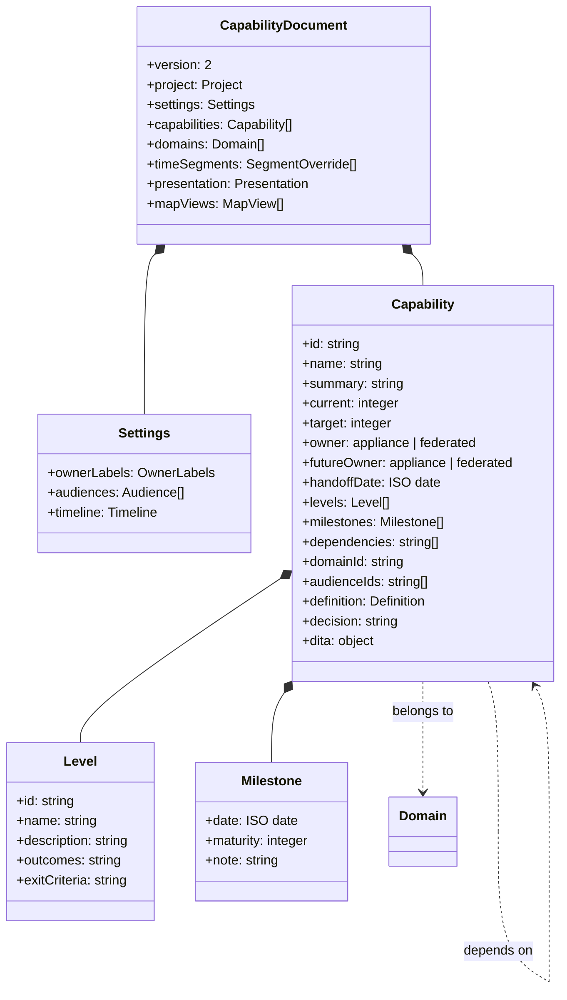
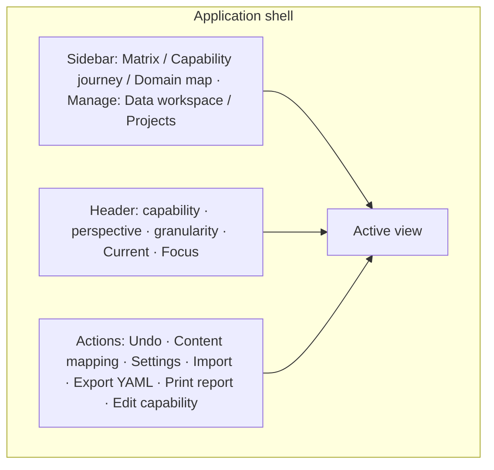
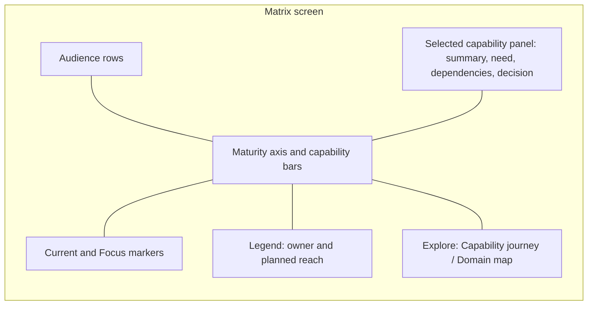
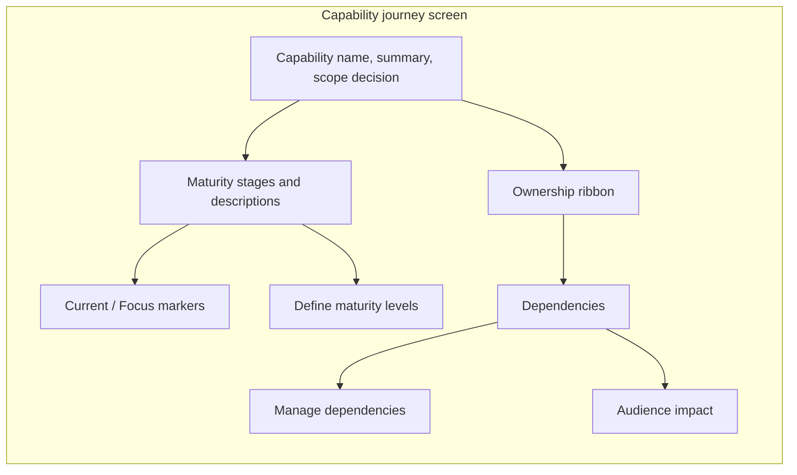
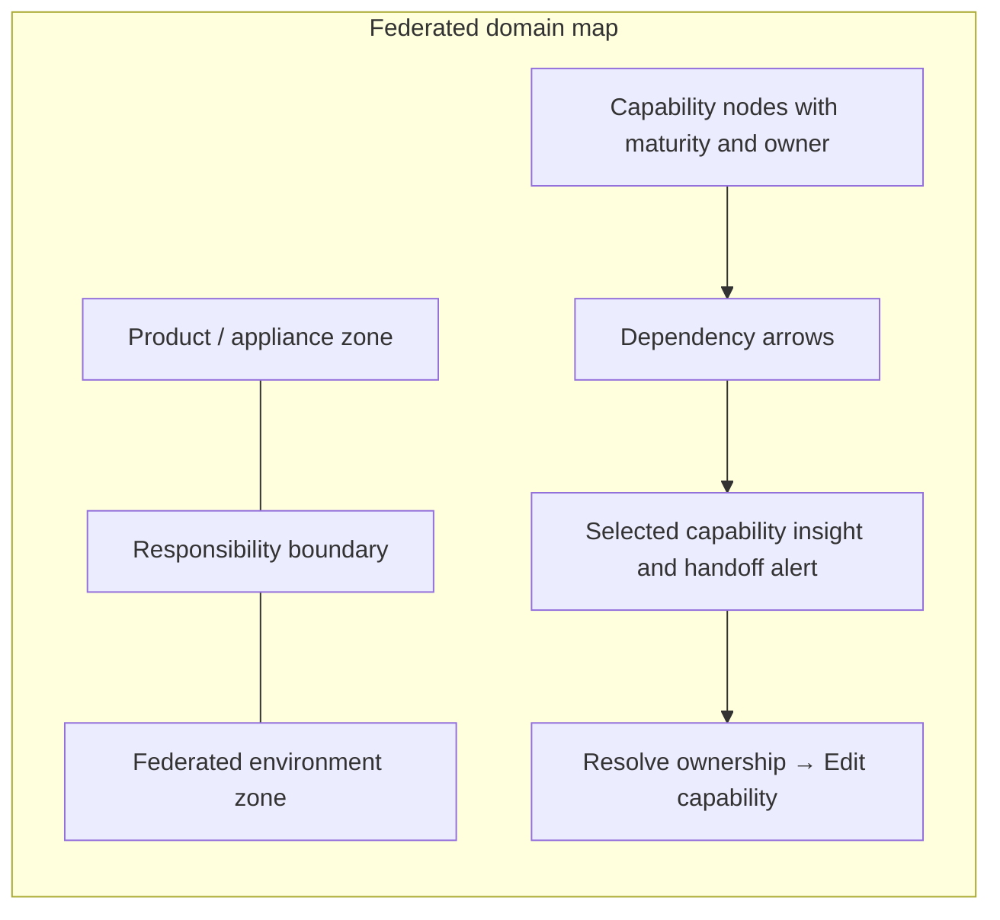
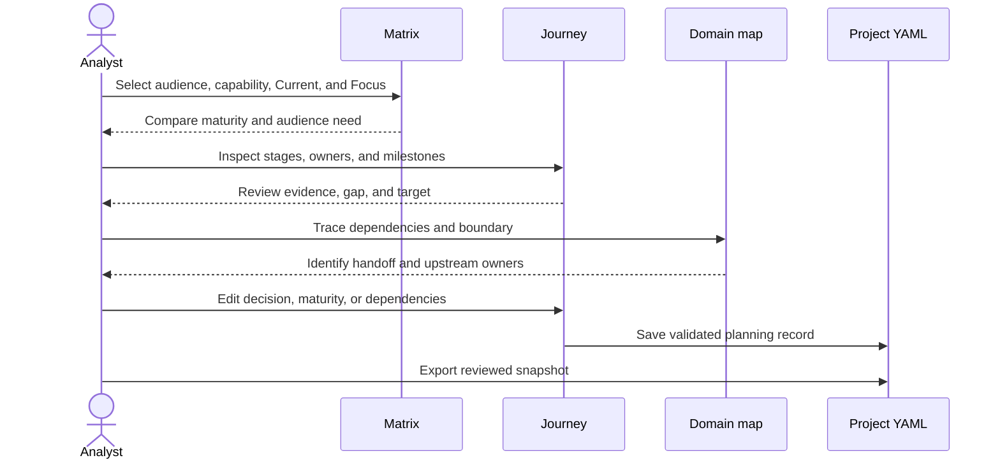

# Analyst user guide

This guide takes an analyst from the first planning question to a reviewed capability document and a planning decision in the Capability and Ownership Matrix. Its sequence follows Robert Horn’s information-mapping approach: concepts explain what something is, processes explain how work flows, procedures give actionable steps, structures show relationships, facts define values, examples demonstrate the data, and troubleshooting helps recover from errors. Each section is labeled by its principal information type so readers can find the kind of information they need.

The application is a planning and visualization tool, not an automated discovery service or an authoritative system of record. Analysts gather and reconcile the source information, prepare the YAML document, and use the application to compare perspectives, expose dependencies, and record proposed maturity and ownership decisions.

## 1. Planning lifecycle

**Information type: Process.** A capability matrix is most useful when it is treated as a lifecycle rather than as a one-time spreadsheet exercise. The analyst defines the decision to be made, gathers evidence, establishes a shared capability and maturity model, creates and validates the YAML document, loads it into the application, uses the linked views to plan, and exports a reviewed snapshot for the next planning cycle.



**Information type: Principle.** The matrix should make a decision more defensible, not make uncertain evidence look precise. Keep observed facts, stakeholder judgments, assumptions, proposed targets, and unresolved questions distinguishable in the source notes and in capability summaries or decisions.

**Information type: Procedure.** Use the following lifecycle when starting a new project or refreshing an existing matrix.

1. **Frame the planning question.** Write down the scope, the decision owner, the intended planning horizon, and the choices the matrix must support, such as which work belongs in a product and which service should be shared.
2. **Identify the evidence and participants.** List relevant product documentation, service catalogs, architecture diagrams, operating procedures, road maps, support data, and subject-matter experts. The application does not collect these sources for you.
3. **Reconcile the evidence.** Confirm capability names and boundaries with the people who deliver, use, fund, advise on, and govern the work. Record source, date, owner, confidence, and disagreement in your working notes so a maturity score can be traced to evidence.
4. **Define the model.** Agree on capability IDs, capability descriptions, maturity-level names and descriptions, the meaning of ownership, dependency semantics, audience perspectives, and the timeline before assigning scores.
5. **Create the project.** In **Projects**, create an empty project (or a copy of the sample) and enter records in the **Data workspace**, or prepare YAML from the [YAML format reference](yaml-format.md) and import it.
6. **Validate the data.** Correct every error in the Data workspace's **Validation** panel or the import preview before interpreting the views; review warnings such as dependency cycles.
7. **Use the views to plan.** Compare an audience’s needs in the Matrix, examine one capability’s path in the Journey, and test its dependencies and ownership boundary on the Domain map.
8. **Record and review decisions.** Update the relevant capability, maturity levels, milestones, dependencies, owners, and settings. Have the appropriate stakeholders challenge the assumptions and proposed handoffs.
9. **Export the reviewed data.** Use **Export YAML** to create a portable snapshot, check it into the project’s approved document store, and use that version as the starting point for the next review.

**Information type: Principle.** The order of these activities matters because a view cannot correct a poorly bounded capability or an unsupported score. Agree on definitions and provenance before using the visualization to make a recommendation.

## 2. Define and gather the data

### Define the decision and scope

**Information type: Concept.** A capability is a stable description of an ability that a product, service, team, or wider domain must provide. It is not necessarily a feature, project, team, or system; define it at the level needed to discuss maturity, ownership, and dependencies without tying its identity to one implementation.

**Information type: Procedure.** Draft each capability by naming the outcome or ability, stating its boundary, and identifying what is explicitly outside that boundary. Ask the people who operate and consume it whether the description is distinct from neighboring capabilities before assigning a permanent ID.

**Information type: Example.** “Deployment metadata” can describe the structured product, task, and deployment context needed by downstream services. A separate “Contextual guidance” capability can describe the guidance presented to a user, while depending on deployment metadata and a content service. These names and relationships come from the sample and must be validated for the project.

### Gather evidence and rate maturity

**Information type: Principle.** A maturity rating should summarize demonstrated capability against a documented rubric, not the analyst’s impression of how advanced a team feels. For each proposed current and target rating, record the evidence, the person who validated it, the date, the assumptions, and any gap between actual practice and planned intent.

**Information type: Procedure.** Gather evidence from the people closest to the work and from artifacts that show the work is repeatable. Compare how the capability is defined, delivered, operated, measured, and improved; then agree which maturity-level description is supported today and which level is an achievable planning target.

**Information type: Fact.** The application ships with nine example maturity levels, numbered M0 through M8, and treats the last position as an open-ended wider-domain horizon. The labels and descriptions are defaults, not an approved industry standard; each capability can have its own editable level names and descriptions, and the level list can be expanded or reordered in the Journey.

**Information type: Principle.** Maturity 8+ means that the wider-domain horizon can continue to evolve; it is not a certification or a fixed maximum. Use levels that stakeholders can distinguish with observable evidence, and avoid assigning a level simply because it appears farther along the scale.

### Define ownership and dependencies

**Information type: Concept.** Ownership identifies who is responsible for delivering a capability at a point in the plan, while a handoff period identifies when responsibility is expected to change. A dependency identifies another capability that must support or enable the selected capability; it does not by itself assign ownership or prove that the dependency is ready.

**Information type: Procedure.** For every capability, identify the current owner, the intended future owner, the handoff period, and the decision or unresolved question behind that choice. Then list only direct dependencies by their stable IDs, and confirm that each dependency exists and is understood by both capability owners.

**Information type: Fact.** The built-in owner IDs are `appliance` and `federated`, although users can change their displayed names in **Settings**. The editor’s handoff period defaults to the end of the timeline; an explicitly entered handoff date changes which owner is shown from that period onward.

### Choose perspectives and timeline

**Information type: Concept.** An audience perspective is a lens for asking what a stakeholder needs to understand or decide about a capability. The default perspectives are client, consultant, product team, leadership, and wider domain; their labels, roles, and stated needs can be edited in **Settings**.

**Information type: Fact.** The timeline has a granularity of month, quarter, half-year, or year, a start date, and two to sixty periods. The `asOf` date anchors each capability’s `current` maturity value, while the final timeline period anchors its `target` value; dated milestones can describe intermediate or historical values.

**Information type: Concept.** The header’s **Current** and **Focus** controls select the two periods compared in the views, and either period can be before or after the other. **Current** is the reference date and **Focus** is the date being compared; neither control is a current/future switch, and changing them for an analysis does not rewrite the YAML `asOf` anchor.

**Information type: Principle.** A timeline should match the way the planning group makes commitments. Choose monthly detail only when decisions can be meaningfully made at that cadence; otherwise, use quarters, half-years, or years to avoid suggesting more precision than the evidence supports.

## 3. Prepare the YAML document

**Information type: Structure.** YAML is the canonical project document. One version 2 document is one project: it holds an immutable `project` identity, `settings`, and the project's capabilities, domains, time-segment notes, presentation settings and saved map views. Any collection may be empty, so a new project can start with no capabilities.



**Information type: Example.** The following excerpt shows a capability with the principal planning fields. Use the complete [YAML format reference](yaml-format.md) for settings, levels, dates, and validation details.

```yaml
version: 2
project:
  id: prj-k3m9x2q7aa1b
  name: Guidance roadmap
  createdAt: 2026-10-29T09:00:00Z
  updatedAt: 2026-10-29T09:00:00Z
settings:
  ownerLabels:
    appliance: Appliance
    federated: Federated
  timeline:
    granularity: quarter
    start: 2026-10-01
    periods: 9
    asOf: 2026-10-01
  audiences:
    - id: client
      label: Client
      description: Uses and funds the capability
      need: Clear outcomes and a dependable operating experience.
capabilities:
  - id: contextual-guidance
    name: Contextual guidance
    summary: Relevant guidance at the point of need.
    current: 3
    target: 5
    owner: appliance
    futureOwner: federated
    handoffDate: 2028-10-01
    decision: Agree on the handoff to the shared content service.
    domainId: guidance
    audienceIds: [client]
    dependencies:
      - deployment-metadata
      - content-service
    levels:
      - id: emerging
        name: Emerging
        description: Explore the need.
      - id: initial
        name: Initial
        description: Describe the capability.
      - id: defined
        name: Defined
        description: Define the model.
      - id: managed
        name: Managed
        description: Operate a first version.
      - id: measured
        name: Measured
        description: Measure outcomes.
      - id: optimized
        name: Optimized
        description: Optimize the handoff.
    milestones:
      - date: 2027-10-01
        maturity: 4
    dita:
      audience:
        - client
      maturity: phase-3
      ownership: appliance-native
domains:
  - id: guidance
    name: Guidance and content
```

**Information type: Procedure.** Create a project copy of the bundled example, then replace its illustrative values instead of editing the only copy. Give each capability a unique, stable ID; write a concise name and summary; set `current` and `target`; specify both owners; add known dependencies; and record the rationale in `decision`.

**Information type: Procedure.** Define `levels` from the project's approved maturity rubric; `current`, `target` and milestone values are whole-number ranks into that list, and validation rejects values outside it. Add `milestones` only when there is evidence or an agreed planning event at a date between the current anchor and target horizon; save dates as ISO `YYYY-MM-DD` values.

**Information type: Procedure.** Add `settings` when the project needs audience-specific wording, custom owner labels, or a different planning horizon. Keep the built-in owner IDs `appliance` and `federated` even when their visible labels are renamed, and make sure each audience has a stable `id`, label, role description, and stated need.

**Information type: Principle.** Treat the `dita` object as proposed content metadata, not as a validated CCMS configuration. Record only mapping hypotheses that the content team can review, and do not interpret the example’s audience, maturity, or ownership tags as approved filter rules.

## 4. Start the application and import data

### Choose a runtime

**Information type: Concept.** The browser preview and the Tauri desktop app use the same interface and the same validation rules but different storage. The browser keeps projects in the current tab only, so export them before refreshing or closing it. The desktop app stores each project as `<app-data>/projects/<project-id>/capabilities.yaml`, validates every change again with the Python sidecar, and reports **Saved** only after the file is written.

**Information type: Procedure.** To run the browser preview, install the project dependencies and start Vite from the repository root.

```bash
npm install
npm run dev
```

**Information type: Procedure.** To run the Tauri app during development, build the Python sidecar and start the desktop shell. Python 3.10 or later, a virtual environment, and the platform prerequisites for Tauri 2 are required.

```bash
python3 -m venv .venv
.venv/bin/python -m pip install -r requirements.txt
npm install
npm run sidecar:build
npm run tauri dev
```

**Information type: Procedure.** Import project data by choosing **Import** in the header (or **Import YAML or CSV** in Projects) and selecting a `.yaml`, `.yml` or `.csv` file. The app previews the record counts and any issues before writing anything. If the file has the same project ID as an existing project, choose **Open existing**, **Replace existing** or **Import as copy**; nothing is merged. A version 1 file shows a migration preview and keeps the original bytes.

**Information type: Fact.** An import with errors is not applied. Choose **Fix in source editor** to correct the YAML with live validation, then check it again. Invalid values such as an owner typo or a fractional maturity are reported, never silently replaced.

## 5. Navigate the screens

**Information type: Structure.** The interface keeps one planning context across the three views and the two management screens: the selected capability, selected audience perspective, Current reference period, and Focus comparison period. The sidebar changes the view without resetting that context, while the header controls select the capability, perspective, timeline granularity, and comparison periods.



### Matrix

**Information type: Concept.** The Matrix is the comparison screen for examining how capability reach and maturity relate to stakeholder perspectives. Its audience rows, maturity axis, capability bars, ownership legend, and selected-capability panel help frame a discussion; they do not replace evidence or stakeholder agreement.



**Information type: Procedure.** To inspect a capability in the Matrix, choose it from the **Selected capability** control or select its bar. Choose an audience under **Perspective**, set **Current** and **Focus** to the dates you want to compare, and read the audience need, dependencies, ownership decision, and maturity markers in the adjacent panel.

**Information type: Fact.** Each audience row shows every capability whose `audienceIds` include that audience. A bar starts at the capability's maturity at the Current date and reaches its target (or its Focus maturity, if higher). Capabilities with no audience appear in an **Unassigned** row.

### Capability journey

**Information type: Concept.** The Capability journey is the detail screen for one capability’s maturity definition and planned path. It combines maturity-level descriptions, stage outcomes and exit criteria, the values at Current and Focus, an ownership ribbon, the definition sections (purpose, scope, exclusions, outcomes, evidence, notes), dependencies, audience guidance by stage, and the scope decision. Section labels and visibility are configured in **Settings**; missing content shows a “Not recorded” state rather than sample prose.



**Information type: Procedure.** To review the maturity path, choose a stage in the journey to read its description. Use **Set as current** or **Set as target** when the agreed rating changes; the application adjusts the corresponding maturity value and saves the record through the normal validation path.

**Information type: Procedure.** To revise the rubric for one capability, choose **Define maturity levels**, edit the level names or descriptions, reorder or remove levels, or add a level, then choose **Save levels**. Keep at least two named levels; when levels are reordered or removed, the editor remaps the capability’s current, target, and milestone values to the revised list.

**Information type: Procedure.** To revise relationships, choose **Manage dependencies**, add or remove the capabilities that this capability relies on, and choose **Save dependencies**. The dependency list is directional: the selected capability names its prerequisites, and the Domain map draws the relationship toward the capability that depends on them.

### Federated domain map

**Information type: Concept.** The Federated domain map is the relationship screen for tracing dependencies and discussing responsibility boundaries. Capability nodes show the owner at the Focus period, while dependency arrows connect prerequisites to dependent capabilities.



**Information type: Procedure.** To trace a relationship, select a node and inspect the selected-capability panel for upstream dependencies, the current and future owner decision, and the maturity at Focus. Choose **Resolve ownership** to open the capability editor, clarify the decision with the relevant owners, and save the agreed change.

**Information type: Procedure.** Owners appear as anchor nodes, each domain as a labelled region connected to its owner at the Focus date, and capabilities without a domain in an **Unassigned** region. Drag a card to pin it; use the zoom buttons, scroll or pinch, **Fit all** and **Fit selection** to navigate. Save the arrangement as a named view (**Save**, **Save as…**, **Rename**, **Duplicate**, **Delete**). **Rebuild layout** previews a new organic arrangement that keeps pinned cards unless you choose to reset them; apply or cancel it, and use **Undo layout** to go back.

**Information type: Fact.** Positions are remembered per owner/domain context, so a card that changes owner at a later Focus date returns to its earlier spot when you move Focus back. Treat the map as a dependency and ownership discussion aid, not a formally governed architecture diagram.

## 6. Edit the project and its settings

### Edit a capability

**Information type: Procedure.** To update a capability, choose **Edit capability** from any view, make the agreed changes, and choose **Apply changes**. The tray covers name, summary, scope decision, maturity, owners, handoff period, milestones, domain, audiences, definition sections, audience guidance and dependencies. Fields are checked as you type; errors block **Apply**, and the draft stays marked **Unsaved draft** until you apply or discard it. **Undo** in the header reverses the last applied change.

### Use the Data workspace

**Information type: Procedure.** Choose **Data workspace** to create, edit and delete capabilities, maturity levels, audiences, domains and time segments, or to edit the YAML source directly. Choose a record to open its tray. Deleting a record first lists everything that refers to it and asks you to remove or reassign those references; nothing cascades silently.

**Information type: Procedure.** In **Relationship table**, choose any two different dimensions for rows and columns (capability, maturity stage, audience, domain, time segment) and use **Swap** to exchange them. Each cell lists the capabilities that share both headings; an empty cell means no recorded relationship, not zero maturity. Choose a heading to edit that record, a capability to edit it, or **Edit relationship** actions such as adding an audience membership. The Maturity stage axis needs a capability filter because stage definitions belong to each capability. With Time segment on an axis, maturity and owner are calculated at each segment start; edit the dated milestone rather than the number.

**Information type: Procedure.** The **Validation** panel lists every issue with its severity and a corrective message. Search or filter it, and choose an issue to open the record with the offending field focused.

**Information type: Procedure.** To represent an intermediate event or planned step, add a timeline milestone, select its date, and enter the maturity value that applies then. Current maturity is anchored at `settings.timeline.asOf`, target maturity is anchored at the final timeline period, and the application estimates intervening maturity by interpolating between dated points.

### Configure Settings

**Information type: Procedure.** Choose **Settings** to change the displayed names for the Appliance and Federated owners, open or add audience perspectives, open the timeline, and rename, reorder or hide the Capability journey sections. Timeline changes (granularity, number of periods, start date and `asOf`) show an impact preview of milestones, handoffs and segment notes that would fall outside the new range.

**Information type: Fact.** Timeline granularity can be monthly, quarterly, biannual, or yearly, and the number of periods must be from two through sixty. Dates are stored as ISO strings, so changing the granularity changes period labels and the displayed span without changing the stored milestone dates.

**Information type: Principle.** Edit `asOf` only when the project’s definition of the current maturity anchor changes; use the header’s Current selector to compare a different reference period for an analysis. This distinction preserves the meaning of the source rating while still allowing the group to examine a different time slice.

### Review Content mapping

**Information type: Concept.** **Content mapping** is a read-only planning panel for proposed DITA audience, maturity, and ownership metadata on the selected capability. It can help a content analyst frame a conversation, but it does not validate the mapping against a content model.

**Information type: Fact.** The application does not publish embedded content, create production DITAVAL rules, call a CCMS Deploy API, or generate PDF manuals. Validate any proposed mapping with the content team before using it in a publishing process; CCMS deployment and PDF generation remain future integration targets.

## 7. Use the matrix to make and communicate a plan

**Information type: Process.** A planning conversation should move from comparison to explanation to relationship testing before stakeholders settle on an action. The shared selection lets participants examine the same capability from multiple views without losing the audience or periods under discussion.



**Information type: Procedure.** Begin the meeting with one agreed capability and audience, then choose a Current reference period and a Focus period that matches the planning question. In the Matrix, state the evidence behind the current maturity and explain whose need the target is intended to meet.

**Information type: Procedure.** Continue in the Journey by comparing the maturity descriptions at the two periods, reviewing each milestone, and testing whether the proposed target is supported by a feasible sequence of work. Use the level descriptions to expose disagreement about what “ready” or “managed” means instead of averaging incompatible judgments.

**Information type: Procedure.** Continue in the Domain map by tracing each prerequisite to its owner and checking whether the proposed handoff leaves an unowned responsibility. Record the agreed owner, handoff period, dependency, or unresolved decision in the capability editor, and obtain confirmation from the affected owners.

**Information type: Principle.** Treat the result as a versioned planning snapshot, not as proof that future work has happened. Keep the evidence and approval record with the project’s normal decision artifacts, and update the YAML only when the responsible people agree that the plan or its supporting facts have changed.

## 8. Save, export, and reuse data

**Information type: Concept.** Exported YAML is the complete portable project, including saved map views; CSV export is an equivalent, re-importable alternative. The printed view is a meeting aid for the active screen, while the YAML is the structured source needed to continue editing, compare versions, or transfer the planning model.

**Information type: Procedure.** Choose **Export YAML** to download the current project as `<project-name>.yaml` (or use **YAML** or **CSV** beside any project in **Projects**). Save that file in the project’s approved repository or document store, include the review date and decision context in the surrounding project record, and use the exported file as the starting point for the next cycle.

**Information type: Fact.** In the browser preview, projects live in the current tab and are lost if it is refreshed or closed before export; the header shows **Session only · not exported** until you export. In the desktop app, each applied change is saved to the project's managed file. If a save fails or the file changed outside the app, the header offers **Retry**, **Reload from disk** or **Save a copy**, and your working copy is kept. Deleted projects move to the trash in **Projects** and can be restored.

**Information type: Procedure.** Choose **Print report** when stakeholders need a paper or PDF copy of the active view. The desktop app invokes the Tauri print command; the browser preview invokes the browser’s print dialog. Set the capability, perspective, timeline, and active view before printing because the control prints the current view, not a combined report of all three screens.

**Information type: Principle.** Use the exported file as the controlled source for handoffs between analysts and as the input to later planning cycles. Review diffs between exports so changes to maturity, ownership, dependencies, audience definitions, and timeline settings are deliberate and traceable.

## 9. Troubleshooting and guardrails

**Information type: Troubleshooting.** If an import fails, read the issue list in the preview: each issue names the field path and a corrective action. Common causes are a missing `version: 2`, a fractional or out-of-range maturity value, an owner other than `appliance` or `federated`, an impossible date such as `2026-02-30`, a milestone on an anchor date, and a dependency, domain or audience ID that does not exist.

**Information type: Troubleshooting.** If a change disappears after reopening the browser preview, export before closing or refreshing; the browser keeps projects only for the session. If a desktop project file was edited outside the app and no longer validates, the app opens it in a repair view with the YAML and its issues; nothing is changed until you apply a valid version.

**Information type: Troubleshooting.** If a capability is missing from a Matrix row, check its audience membership in the Data workspace. If it is missing from the map, check the map filters and the Focus date (ownership can change at the handoff date). Journey guidance appears only where it is recorded for a capability or as a default for that level ID.

**Information type: Troubleshooting.** If a dependency is absent from the Domain map, check that the prerequisite is visible under the current map filters. Missing references are validation errors in both runtimes, so a project with a broken dependency cannot be applied or imported.

**Information type: Guardrail.** Do not describe the example data as client-approved, the DITA panel as a validated CCMS configuration, a printed view as a generated PDF manual, or a visual dependency as an approved architecture decision. Each of those claims requires review and evidence outside the current prototype.

## 10. Related reference

**Information type: Reference.** The [YAML format reference](yaml-format.md) defines document fields, accepted values, CSV interchange, migration and validation. The [project README](https://github.com/mattbriggs/Capabilty-Matrix-App/blob/main/README.md) covers installation, desktop development, and documentation commands.
