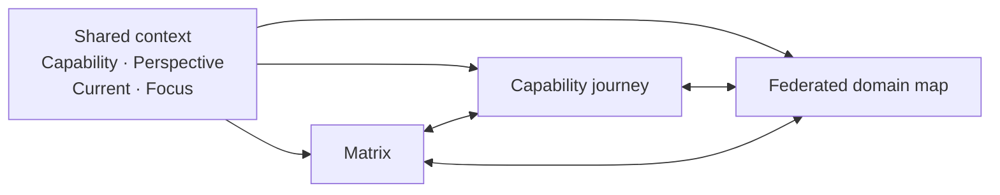
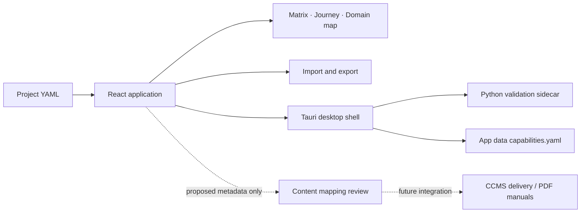

# Capability and Ownership Matrix

The Capability and Ownership Matrix helps analysts define capability data, compare maturity and ownership across audiences, and plan how responsibilities should evolve. The analyst user guide follows the work from gathering evidence through importing YAML, exploring the screens, recording decisions, and exporting the reviewed plan.

## Start with the analyst guide

The [analyst user guide](guide.md) is the end-to-end manual for building and using a project matrix. It explains the planning lifecycle, how to collect and shape source data, how to use each screen, and how to export and reuse the capability document.

The [YAML format reference](yaml-format.md) defines the document structure, settings, capability fields, maturity values, dependencies, timeline dates, and runtime validation differences. Start with the reference when preparing an import file or checking a validation error.

## One shared planning context

The application provides three connected views for the same selected capability and audience. The Matrix supports comparison, the Capability journey explains one capability’s progression, and the Federated domain map shows dependencies and ownership boundaries.

The **Current** period is the reference point and **Focus** is the comparison point; either may be in the past or future. YAML maturity values are anchored at `settings.timeline.asOf` and the final timeline period, with optional dated milestones between them.

## Data flow and scope

The versioned YAML document is the portable project data source. The browser preview holds changes in memory until export, while the Tauri desktop app validates and saves successful changes in its application data directory.

The application does not discover source data, publish to a CCMS, validate a production DITA configuration, or generate PDF manuals. The bundled [capability document](https://github.com/mattbriggs/Capabilty-Matrix-App/blob/main/src/data/capabilities.yaml) is illustrative; replace it with project-validated data before planning.
