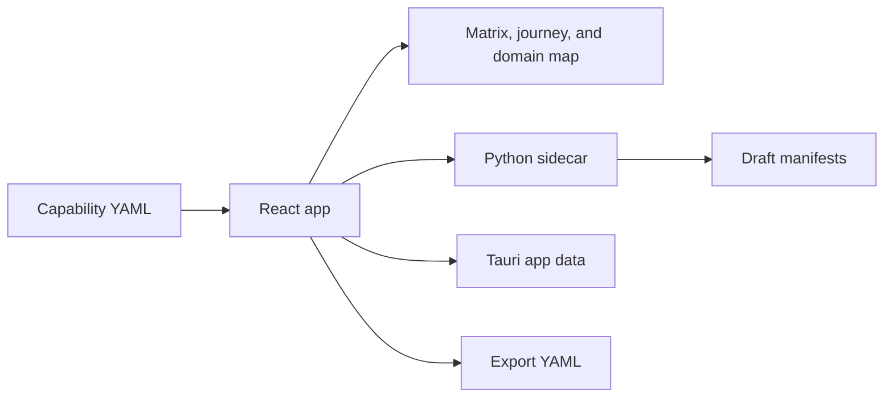

# Capability and Ownership Matrix

The Capability and Ownership Matrix is a planning tool for comparing capability maturity, ownership, dependencies, and planned evolution across audiences and domains.

## The three views

| View | Use it to |
| --- | --- |
| **Matrix** | Compare capability maturity across audience perspectives. |
| **Capability journey** | Inspect current and target maturity, dependencies, and ownership for one capability. |
| **Federated domain map** | Explore capability relationships and appliance/federated boundaries. |

The selected capability, audience perspective, and current/future state remain shared as you navigate between views.

## Data flow

The app's bundled sample is [`src/data/capabilities.yaml`](https://github.com/mattbriggs/Capabilty-Matrix-App/blob/main/src/data/capabilities.yaml). Its content is illustrative. Read the [user guide](guide.md) to configure a project and use the import/export workflow, or the [YAML format reference](yaml-format.md) to prepare a file.

!!! note "Content integration status"
    The DITA panel records proposed mappings only. It does not validate a CCMS configuration or publish embedded content or PDF manuals.
