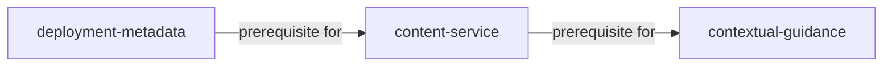

# YAML format reference

YAML is the canonical capability document used by the Capability and Ownership Matrix. This reference describes the recommended exported document, field meanings, and the differences between browser and desktop validation; use it with the [analyst user guide](guide.md) when preparing or reviewing project data.

## Document shape

The recommended document is a YAML object with `version`, `settings`, and a nonempty `capabilities` list. The importer also accepts a bare list of capability records, but a bare list cannot preserve project settings when exported.

```yaml
version: 1
settings:
  ownerLabels:
    appliance: Appliance
    federated: Federated
  timeline:
    granularity: quarter
    start: 2026-10-01
    periods: 9
    asOf: 2026-10-01
  audiences:
    - id: client
      label: Client
      description: Uses and funds the capability
      need: Clear outcomes and a dependable operating experience.
capabilities:
  - id: contextual-guidance
    name: Contextual guidance
    summary: Relevant guidance at the point of need.
    current: 3
    target: 5
    owner: appliance
    futureOwner: federated
    handoffDate: 2028-10-01
    decision: Agree on the handoff to a shared content service.
    dependencies:
      - deployment-metadata
      - content-service
    levels:
      - name: Emerging
        description: Explore the need.
      - name: Initial
        description: Describe the capability.
      - name: Defined
        description: Define the model.
      - name: Managed
        description: Operate a first version.
      - name: Measured
        description: Measure outcomes.
    milestones:
      - date: 2027-10-01
        maturity: 4
    dita:
      audience: [client, consultant]
      maturity: phase-3
      ownership: appliance-native
```

The bundled [capabilities.yaml](https://github.com/mattbriggs/Capabilty-Matrix-App/blob/main/src/data/capabilities.yaml) contains six illustrative capabilities and project settings. Its capability facts, IDs, maturity values, dependencies, audience wording, and DITA metadata are examples, not an approved project model.

## Document and settings fields

| Field | Required in source | Meaning |
| --- | --- | --- |
| `version` | Recommended | Exported as `1`. The current importer does not reject an unsupported or missing version; version migration is not implemented. |
| `settings` | Optional | Project-wide owner labels, audience perspectives, and timeline. Missing settings are replaced with defaults. |
| `settings.ownerLabels.appliance` | Optional | Display label for owner ID `appliance`; defaults to `Appliance`. |
| `settings.ownerLabels.federated` | Optional | Display label for owner ID `federated`; defaults to `Federated`. |
| `settings.audiences` | Optional | List of audience perspectives. Each item has `id`, `label`, `description`, and `need`. If omitted, the five built-in perspectives are used. |
| `settings.timeline.granularity` | Optional | Period unit: `month`, `quarter`, `biannual`, or `year`. The default is `quarter`. |
| `settings.timeline.start` | Optional | ISO date (`YYYY-MM-DD`) for the first period; defaults to `2026-10-01`. |
| `settings.timeline.periods` | Optional | Number of periods, from 2 through 60; defaults to 9. |
| `settings.timeline.asOf` | Optional | ISO date that anchors each capability’s `current` maturity; defaults to the timeline start. |

Audience IDs should be stable, nonempty identifiers, and the label, role description, and need should be understandable to the planning group. The built-in IDs are `client`, `consultant`, `product-team`, `leadership`, and `wider-domain`; custom IDs can be used, but some Journey audience-impact text is illustrative for the built-in set.

Timeline dates should be valid calendar dates in ISO form. The `start` date, granularity, and period count define the timeline; changing the granularity changes the period labels and span, while milestone dates remain ISO dates.

## Capability fields

| Field | Required in source | Meaning and guidance |
| --- | --- | --- |
| `id` | Yes | Unique, nonempty, stable identifier. Other records refer to it from `dependencies`. Avoid changing it when only the display name changes. |
| `name` | Yes | Nonempty display name for the capability. |
| `summary` | Recommended | Short description of the ability or outcome; defaults to an empty string when omitted. |
| `current` | Yes | Nonnegative numeric maturity value. It is anchored at `settings.timeline.asOf`. |
| `target` | Yes | Nonnegative numeric maturity value planned for the final timeline period. Desktop validation requires it to be at least `current`. |
| `owner` | Yes | Current owner ID: `appliance` or `federated`. |
| `futureOwner` | Yes | Planned owner ID: `appliance` or `federated`. |
| `handoffDate` | Optional | ISO date when the future owner takes responsibility. If omitted, the owner changes at the last timeline period. |
| `decision` | Recommended | Scope, ownership, or planning rationale to discuss with stakeholders; defaults to an empty string. |
| `dependencies` | Recommended | List of IDs of other capabilities this capability relies on. Use `[]` for none. |
| `levels` | Recommended | Ordered maturity-level definitions for this capability; each item has a nonempty `name` and optional `description`. |
| `milestones` | Optional | Dated maturity points between or outside the current and target anchors; each item has an ISO `date` and numeric `maturity`. |
| `dita` | Optional | Proposed DITA/content metadata. Values are planning notes, not validated publishing configuration. |

Maturity values are numeric and correspond to positions in the capability’s ordered `levels` list, starting at zero. The editor supports at least two levels and up to twenty levels. Desktop validation checks that `current`, `target`, and milestone maturity values do not exceed the highest level, and it checks that `target` is not below `current`; use whole numbers that match the ordered levels.

If `levels` is omitted or empty, the application supplies default maturity-level names and descriptions. Explicit level definitions are recommended for project data because they make the rubric portable and visible in exported YAML.

The model estimates maturity at selected dates by interpolating between the `asOf` current value, dated milestones, and the target at the end of the timeline. The selected Current and Focus periods are view controls; they do not overwrite these stored anchors.

## Ownership and dependencies

Ownership uses fixed IDs and editable labels. Use `appliance` for the product-side owner and `federated` for the wider-environment owner; changing the display labels in settings does not change those IDs.

Each dependency must refer to a capability ID in the same document. A record cannot depend on itself, and desktop validation rejects missing dependency IDs; the validator does not check dependency cycles or determine whether an upstream capability is ready.



In the YAML, the dependent record contains the IDs of its prerequisites. For example, `contextual-guidance` lists `content-service` in its own `dependencies` array, while the diagram draws the arrow from the prerequisite to the dependent capability.

## DITA planning metadata

The optional `dita` value is an object for proposed content annotations. The bundled example uses `audience`, `maturity`, and `ownership`, but the current app does not validate those values against a DITA content model.

Do not treat these fields as approved DITA attributes, production DITAVAL filters, or a validated CCMS configuration. The tool does not call the CCMS, deploy embedded content, or generate PDF manuals; validate all proposed mappings with the content team before using them in a publishing workflow.

## Validation behavior

The React importer requires a nonempty capability list, unique nonempty IDs, nonempty names, and nonnegative numeric current and target values. It normalizes omitted optional fields and unknown owner IDs; do not rely on those defaults for project data.

In the Tauri desktop app, the Python sidecar additionally checks that targets are not below current values, levels contain at least two named entries, maturity values fit the level list, owner IDs are valid, and dependencies refer to existing IDs without self-reference. However, the React importer normalizes missing or unrecognized owner values to `appliance` before the sidecar receives them, so an owner typo may not be reported as an error. Supply `appliance` or `federated` explicitly. A failed import or edit is reported and the active document remains unchanged.

The browser preview does not run the sidecar and does not provide equivalent cross-record validation. It does not reject a target below current maturity or a missing dependency reference, and it normalizes unknown owner IDs to `appliance`; these values can produce misleading planning data. Validate the YAML in the desktop app before using the browser preview for planning.

The current importer does not enforce the `version` value, reject dependency cycles, verify that audience IDs in DITA metadata exist in settings, or validate DITA attributes. Treat these as analyst review responsibilities.

## Prepare and import a file

Create a project copy of the sample, replace all illustrative records, preserve stable IDs, and check every dependency after editing or removing capabilities. Keep the project’s maturity rubric and audience descriptions alongside the YAML so reviewers can understand the values rather than infer their meaning from the chart.

Save the file with a `.yaml` or `.yml` extension, then choose **Import YAML** in the application. Desktop validation is recommended before the first planning review; after changes in either runtime, choose **Export YAML** to create `capability-ownership.yaml` and keep that exported version in the project’s approved document store.
